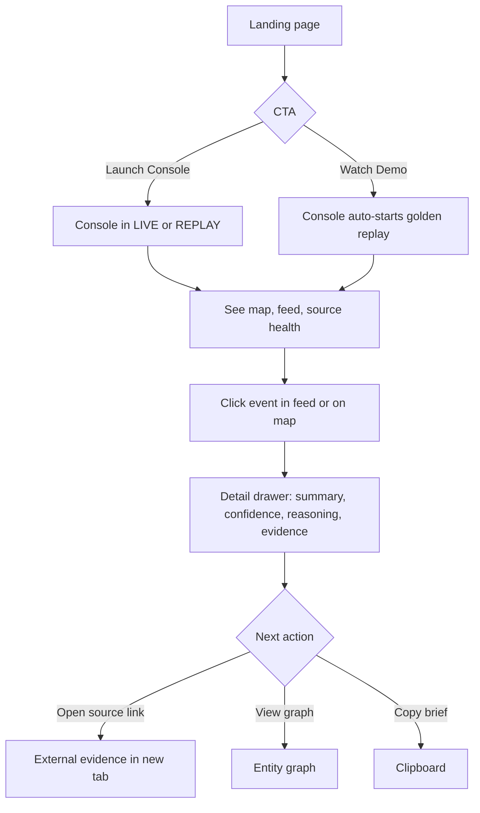
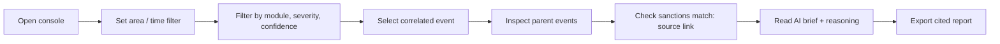
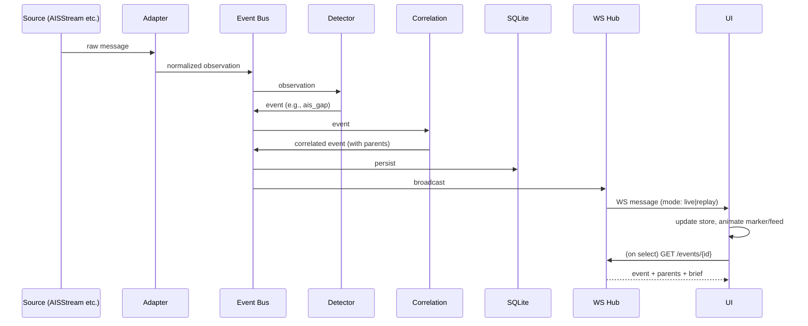
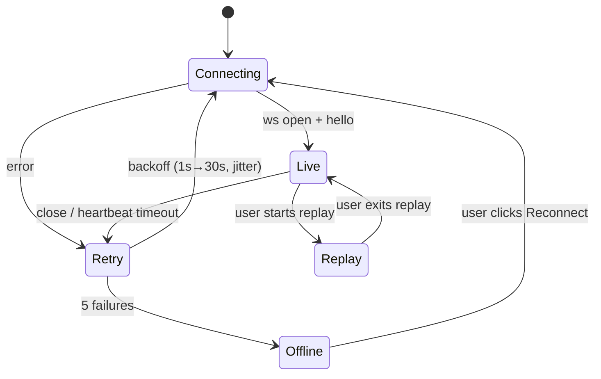
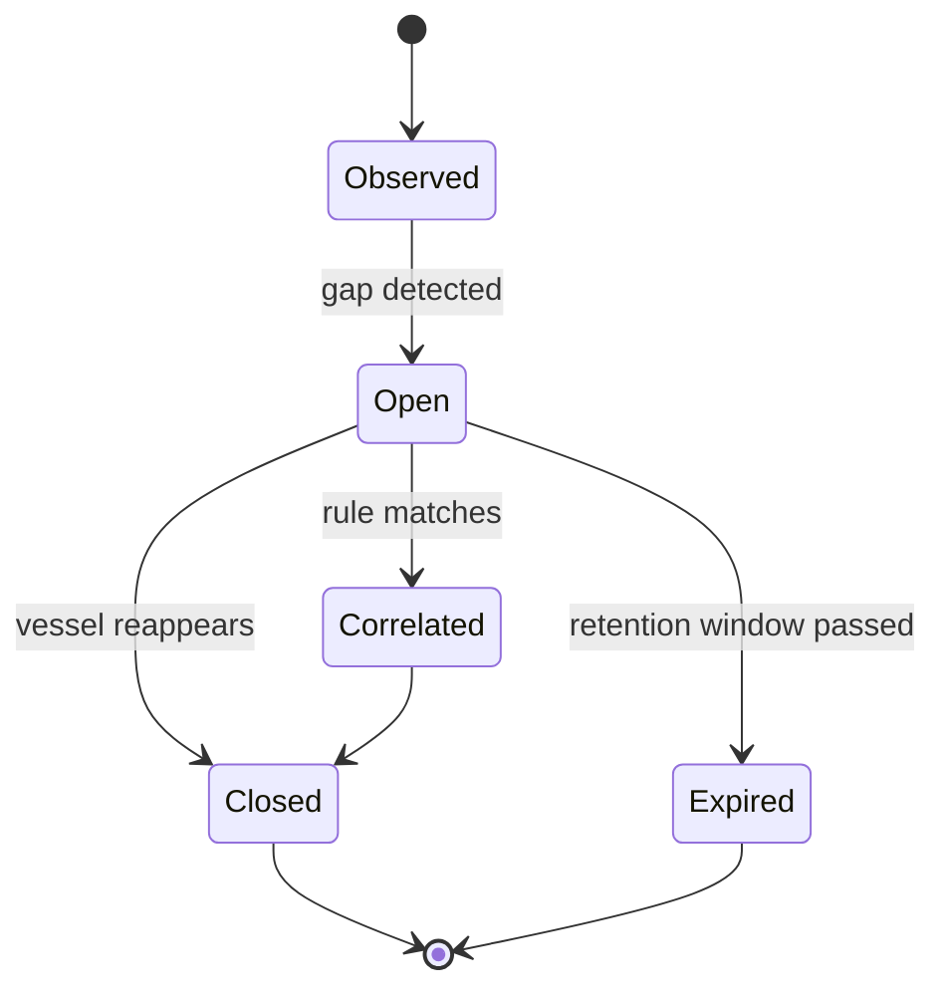

# 06 — App Flow

How users move through Lyncis, and how data moves through the system.

---

## 1. Site Map

```
/                      Landing (marketing)
/console               Main console (map + feed + graph)
/console/events/:id    Event detail (deep link, opens drawer)
/console/sources       Source health
/console/replay        Replay session picker
/about                 Method, limits, ethics
/docs                  README, data sources, limitations
```

## 2. Primary User Flows

### 2.1 First-time visitor → demo



### 2.2 Analyst investigation



### 2.3 Replay demo (golden scenario)

1. Presenter opens `/console` and selects "Golden scenario" (REPLAY badge visible).
2. Vessels move on the map at 5× speed.
3. A vessel's track stops → **gap pulse** appears and the feed adds an `ais_gap` event (low confidence, "possible").
4. SanctionWeb exact-matches the vessel's identifier → a **sanctions badge** appears.
5. Rule R3 fires → **correlated event** (medium) slides into the feed.
6. Presenter opens the drawer → brief generated, evidence links shown.
7. Presenter opens the graph → vessel, organization and region nodes linked.
8. Close with the limitations panel ("what this does not prove").

## 3. Screen Specifications

### 3.1 Landing (`/`)
Sections (matching the supplied theme):
1. Nav: logo, Features, Showcase, Pricing → *replace with* Features, How it works, Console, About; "Sign In" outline pill → *replace with* "Launch Console".
2. Hero: badge, headline with green highlight, subtext, two CTAs, 3D-tilted console mockup with orbiting color dots, scroll-down cue.
3. Stats strip: four cells (for example: *Live sources · Cited events · Replay-ready · $0 to run*). Use only true numbers.
4. How it works: three cards (**Ingest → Link → Explain**).
5. Feature spotlight: "One map. Many signals." with mockup carousel.
6. Features grid: 6 cards (Live map, Gap detection, Sanctions matching, Correlation, AI briefs, Replay mode).
7. Showcase: scenario thumbnails (Maritime, Thermal, Domain exposure, News).
8. Limits and ethics section (honesty builds trust).
9. CTA band: "Open the console".
10. Footer: Product, Company, Docs, Newsletter *(optional, remove if unused)*.

> The reference theme includes a pricing section. Lyncis is free, so use a "Free and open" card or remove the section. Do not show fake paid plans.

### 3.2 Console (`/console`)

```
┌─────────────────────────────────────────────────────────────────┐
│ Top bar: logo · mode badge (LIVE/REPLAY) · time · source health │
├───────────┬─────────────────────────────────────┬───────────────┤
│ Filters   │                                     │ Event feed    │
│ - Module  │            MAP                      │ (virtualized) │
│ - Sever.  │   vessels · tracks · gaps · layers  │               │
│ - Conf.   │                                     │               │
│ - Time    │                                     │               │
├───────────┴─────────────────────────────────────┴───────────────┤
│ Replay bar: ⏮ ⏯ speed 1×/5×/20× · timeline scrubber            │
└─────────────────────────────────────────────────────────────────┘
        Detail drawer slides over the right panel on select
```

**Mobile:** map full screen; feed as bottom sheet; filters in a modal.

### 3.3 Event Detail Drawer
- Header: type, severity icon + label, confidence label, timestamp.
- Summary line (hedged language).
- AI brief (labeled "AI-written summary") or template brief.
- Reasoning list and caveats.
- Evidence list (links).
- Parent events (click to navigate).
- "Raw data" collapsible.
- Actions: Copy brief, Focus on map, View in graph.

### 3.4 Graph View
- Nodes: vessel, organization, domain, region, hotspot, news cluster.
- Edges labeled with rule ID or relation type.
- Click node → highlight related events in the feed.

### 3.5 Source Health
- Row per source: status (OK / Degraded / Down), last success, error count, mode (live/replay).

## 4. Data Flow



## 5. Connection State Machine (frontend)



On `Live` after a retry: fetch `GET /events?from=<last_ts>` to fill the gap before applying new messages.

## 6. Event Lifecycle



A gap event stays **Open** until the vessel reports again; a follow-up event states the new position and the elapsed gap.

## 7. Empty, Loading and Error States

| State | UI behavior |
|---|---|
| Loading map | Skeleton glass card with a green shimmer |
| No events | "No events in this window. Try REPLAY." |
| Source down | Amber badge in the top bar; feed continues from other sources |
| WS offline | Banner with "Reconnect"; the map shows the last known state, marked stale |
| Brief failed | Template brief with a small "template" tag |
| API error | Toast with `request_id`, retry button |

## 8. Keyboard Shortcuts

| Key | Action |
|---|---|
| `J` / `K` | Next / previous event in feed |
| `Enter` | Open selected event |
| `Esc` | Close drawer |
| `Space` | Play / pause replay |
| `G` | Toggle graph |
| `/` | Focus search |

## 9. Analytics (privacy-respecting, optional)

Only aggregate, cookie-less events (page views, replay started). No tracking of individuals.
